# portgraph 依赖分析 · 一页概览

> 讲清楚两件事：**解决什么问题**、**怎么做的**。细节见 [README](README.md)
> （CLI/数据源）与 [docs/deps-report.md](docs/deps-report.md)（角色模型/覆盖全景）。

---

## 解决什么问题

把一个陌生 Qt 桌面工程移植到鸿蒙前，有三个必须先回答的问题。
portgraph 用一次扫描代替人工逐文件翻构建脚本：

| 问题 | 命令 | 一句话输出 |
|---|---|---|
| **能不能移植？** | `analyze <app>` | portable / blocked / uncertain + 阻塞点证据 |
| **到底依赖什么？** | `deps <路径\|应用名>` | 五类角色清单 + 版本要求校验 + 产物获取途径 |
| **产物从哪拿？** | `fetch-deps <app>` | bottle 直链下载 + manifest（CMake/qmake 集成片段） |

> 实证：tdesktop 68 个依赖，首轮人工判断走进了"全部源码交叉编译"的错误
> 路径；portgraph 一次给出 **59 个 bottle 直下 + 9 个需源码编译** 的解。

## 核心模型：一个工程的依赖分五类

```
link        项目期望获取到编译产物的依赖（目标侧 headers + .so/.a）
            —— 缺了，交叉编译/链接失败
build-tool  编译器/构建工具（cmake/protoc/ECM，构建机运行，不部署设备）
            —— 缺了，构建跑不起来；但不影响产物
runtime     运行时依赖（link 依赖的传递 .so 闭包 + dlopen/QLibrary 动态加载）
            —— 缺了，设备上起不来；编译期毫无感知
vendored    项目内自带源码（.gitmodules / 3rdparty/ / FetchContent）
            —— 随项目一起编译，无需外部产物
provided    Qt 模块等，随 Qt for HarmonyOS SDK 部署
（另附 env：CI 脚本安装清单，作交叉核对信源）
```

每个依赖同时携带：**版本要求**（find_package 最低版本 / pkg-config·meson·
autotools·包装函数约束 / conan 范围，多源取最差 → satisfied/conflict）与
**鸿蒙产物获取途径**（hb bottle / cmd-pkgs / 系统自带 / 需源码编译）。

## 架构

```mermaid
flowchart TB
    subgraph SRC["① 数据源（ingest 一次）"]
        HB["Harmonybrew<br/>4741 formula<br/>依赖边 + bottle 直链"]
        CP["cmd-pkgs<br/>1248 预编译包直链"]
        KB["Qt 模块鸿蒙支持矩阵<br/>+ 平台接口白名单"]
    end

    D[("SQLite 依赖图<br/>nodes / edges / interfaces")]

    subgraph SCAN["② 工程提取（qt_scanner，19 类声明信号）"]
        B["构建文件<br/>CMake / qmake / meson / autotools"]
        M["包管理清单<br/>conan / vcpkg"]
        S["源码与仓库<br/>#include / dlopen / .gitmodules"]
        E["CI 脚本<br/>apt / brew install"]
    end

    subgraph CORE["③ 分析（deps_report）"]
        R1["角色归类<br/>link / build-tool / runtime<br/>/ test / vendored / provided"]
        R2["名称匹配<br/>lib 前缀 / -2.0 后缀 / 别名<br/>（swscale→ffmpeg）"]
        R3["版本校验<br/>多源约束取最差"]
        R4["产物解析 +<br/>runtime 传递闭包"]
    end

    OUT1["人读报告<br/>（每条依赖带文件:行号证据）"]
    OUT2["--json 机器报告<br/>（供 agent 消费）"]
    OUT3["fetch-deps<br/>bottle 下载 + manifest"]

    HB --> D
    CP --> D
    KB --> D
    B --> D
    M --> D
    S --> D
    E --> D
    D --> R1 & R2 & R3 & R4
    R1 & R2 & R3 & R4 --> OUT1 & OUT2
    D --> OUT3
```



分层要点：

- **数据层**：Harmonybrew formula 提供"包→包"依赖边与 bottle 直链，
  cmd-pkgs 补预编译产物，Qt 模块矩阵给"哪些 Qt 模块鸿蒙可用"
- **提取层**：19 类声明信号全部来自**构建文件原文**（不猜），版本号
  连 `set(var x)` 变量、自定义包装函数 `PACKAGE x MINIMUM_VERSION v`
  都做了解析（qBittorrent / qTox 实证）
- **分析层**：runtime 不靠声明——由 link 依赖沿依赖图 runtime 边推导
  传递闭包（bottle 不捆绑依赖，漏拉即设备 dlopen 失败），并给出
  `needed_by` 引入链
- **输出层**：LLM 负责推理、tool 负责事实——每条结论可回溯到
  `文件:行号` 证据，同名异义（MPC vs mpc）等启发式错配留人工核对

## 快速上手

```bash
python portgraph.py deps <项目路径或已扫描应用名>          # 人读报告
python portgraph.py deps <app> --json                     # 机器可读
python portgraph.py fetch-deps <app> --dry-run            # 产物预览
```
