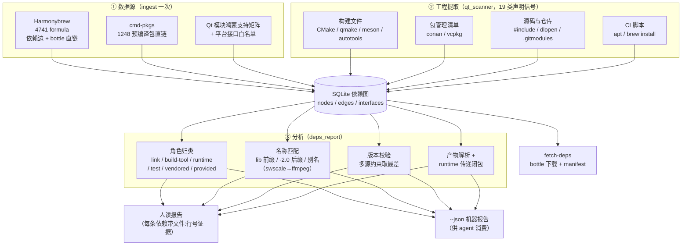
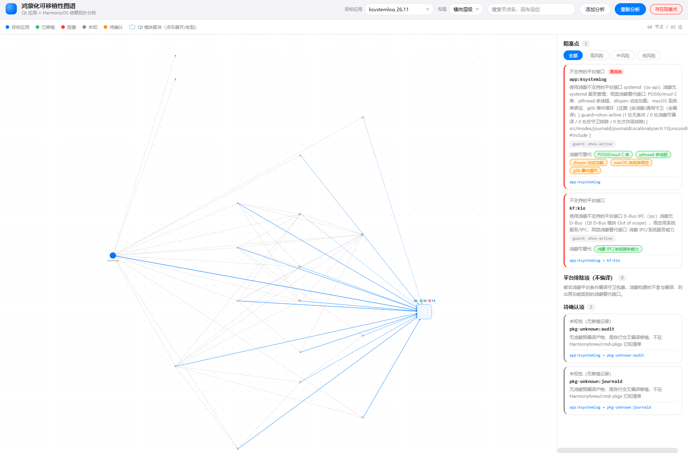

# portgraph 依赖分析 · 模块介绍报告

> 读者：第一次接触本模块的开发者与 AI agent。读完应能回答四个问题：
> **它解决什么问题？怎么设计的？吃进什么、吐出什么？做不到什么？**
> CLI 与数据源细节见 [README](README.md)，角色模型/覆盖全景见 [docs/deps-report.md](docs/deps-report.md)。

---

## 一、它解决什么问题

场景：拿到一个陌生 Qt 桌面应用，要移植到 HarmonyOS。动手改代码之前必须先回答三个问题，portgraph 用三条命令分别回答：

| 问题 | 命令 | 输出 |
|---|---|---|
| 能不能移植？ | `analyze <app>` | portable / blocked / uncertain + 阻塞点证据 |
| **到底依赖什么？** | **`deps <路径\|应用名>`（本报告主角）** | 依赖全景：每个依赖什么角色、版本要求是否满足、鸿蒙产物从哪拿 |
| 产物从哪拿？ | `fetch-deps <app>` | bottle 直链下载 + 集成 manifest |

为什么不能靠人翻构建脚本？三个坑（以 tdesktop 为实证，68 个依赖）：

- **漏**——依赖不只在 `find_package` 里。还藏在 `target_link_libraries` 裸名、`FetchContent` 网络拉取、git submodule、CI 脚本 `apt install`、源码 `dlopen` 里，人工翻一遍很难一个不漏；
- **错**——最容易犯的错是"编译过了就没事"。交叉编译只需要 headers + 库，但应用跑在设备上还需要**传递的运行时 .so**——bottle 不捆绑依赖，漏拉一个，设备上直接起不来，而编译期毫无感知；
- **慢**——68 个依赖逐个查"鸿蒙上有没有、版本够不够"，人工要数小时且不可复现。

`deps` 一次扫描把三个坑一起填掉：tdesktop 给出 **59 个 bottle 直下 + 9 个需源码编译** 的明确清单。

## 二、顶层设计（通俗版）

设计上只有三句话。

### 第一句：按"缺了会怎样"给依赖分类，而不是按"它是什么"

传统依赖清单只回答"用了 zlib"。移植者真正关心的是**缺了会发生什么**——因为补救动作完全不同：

| 角色 | 通俗说法 | 缺了的后果 | 该做什么 |
|---|---|---|---|
| `link` | 要"接进"应用的库 | 编译/链接失败 | 拿产物：bottle 直下或源码交叉编译 |
| `build-tool` | 干活的工具（cmake、protoc） | 构建机跑不起来 | 构建机装好即可，与设备无关 |
| `runtime` | 应用跑起来才需要的 .so | 设备上起不来，编译期无感知 | 部署到 `entry/libs/arm64-v8a/` |
| `vendored` | 项目自带源码的库 | 无 | 随项目一起编译 |
| `provided` | Qt 模块 | 无 | 随 Qt for HarmonyOS SDK 部署 |
| `test` / `env` | 测试专用 / CI 环境清单 | — | 不进发行包 / 只作交叉核对 |

### 第二句：只信构建文件原文，每个结论都能翻出证据

扫描器**不执行、不猜测**，逐行读文件里 19 类依赖声明信号（见第三节），报告里每条依赖都附 `文件:行号` 证据——agent 引用结论时可回溯，人可复核。这就是"**LLM 负责推理、tool 负责事实**"的分工。

### 第三句：列出依赖只是半件事，还要接上"鸿蒙从哪拿"

分析器背后是一张预先建好的 SQLite 依赖图：Harmonybrew **4741 个** formula 的"包→包"依赖边与 bottle 直链、**1248 个** cmd-pkgs 预编译包、Qt 模块鸿蒙支持矩阵。工程里捞到的每个依赖名都去这张图上对号入座：

- 有 bottle → 给直链 + 鸿蒙版本，并校验版本要求（`✓ 满足` / `conflict` 警告）；
- 只有源码 → 给仓库 URL，标"需源码交叉编译"；
- 是 Qt 模块 → 给鸿蒙支持状态；
- 是平台专属（X11/AppKit/iphlpapi）→ 标注不适用，交 `analyze` 的宏守卫证据判定能否裁剪。

### 运转流程



四层读法：**数据层**（一次性 ingest 建图）→ **提取层**（工程里捞声明信号）→ **分析层**（角色归类、名称匹配、版本校验、运行时传递闭包）→ **输出层**（人读报告 / JSON / 下载落地）。

## 三、模块边界

### 3.1 输入边界——吃进什么

两类入口：本地工程路径（自动入库，幂等重扫）或已扫描应用名（用 scan 记录回溯路径）。

能识别的依赖声明信号（19 类，全部来自文件原文）：

| 层面 | 信号 | 举例 |
|---|---|---|
| CMake | `find_package` / `pkg_check_modules` / `target_link_libraries` 裸名·`-lfoo`·`-framework` / `find_library` / `FetchContent`·`ExternalProject`·`CPM` / `find_program`·`COMMAND` / 项目自定义包装函数 | `find_package(OpenSSL 3.0.2 REQUIRED)` |
| qmake | `QT +=` / `LIBS += -lfoo` / `PKGCONFIG +=` | smplayer |
| meson | `dependency('名', version:)` / `find_library` / `meson_version`·`cpp_std` / `subproject()` | audacious `glib-2.0 >= 2.36` |
| autotools | `PKG_CHECK_MODULES` / `AC_CHECK_LIB` | `zlib >= 1.2` |
| 包管理清单 | conanfile（范围 `[>=1.2 <2]`）/ vcpkg.json | keepassxc |
| 源码 | `#include` 三方库头（zlib/openssl/boost 等 16 类）/ `dlopen`·`QLibrary`·`QPluginLoader` 字面量 | tdesktop |
| 仓库结构 | `.gitmodules` / `3rdparty/` 目录 | — |
| CI 脚本 | `.github/`·`.ci/`·顶层 `*.sh` 里的 `apt/brew/pacman install` | flameshot 22 个 |

**看不见的**（明确不支持，报告不装懂）：`${VAR}` 引用的链接项；运行时拼接的动态库名（`QLibrary(name + ".so")`）；meson `.wrap` 内容；qmake 平台作用域块的归属区分；只写在 README/INSTALL 而构建文件从未声明的"运行期才用"的依赖（如 qBittorrent 的 Python ≥ 3.13——CI 环境清单交叉核对可部分补漏）；Bazel/Gradle/SCons 等其他构建系统。

### 3.2 分析边界——怎么处理

- **纯静态**：不执行 cmake/configure，只读文本。快、可离线、可复现；代价是动态行为看不见。
- **runtime 是推导出来的**：构建文件从不声明"我运行时需要库 X"——它由 link 依赖沿包图 runtime 边递归推导（bottle 不捆绑依赖），并给出 `needed_by` 引入链。
- **名称匹配是启发式**：CMake 包名 ≠ 鸿蒙包名（`ZLIB`→zlib、`libavcodec`→ffmpeg、`swscale`→ffmpeg），靠别名表 + 前缀/后缀规则；同名异义（多精度库 MPC vs 播放器 mpc）可能错配——产物 URL 落地前应人工核对。
- **版本约束取最差**：同一依赖被多来源声明版本（find_package + pkg-config + conan）时，任一冲突即 conflict。

### 3.3 输出边界——不承诺什么

- **不保证运行时完整**：变量拼接的动态加载无法静态确定，会缺报；设备上的最终验证以实机为准。
- **不替你做决策**：optional 依赖裁不裁、版本 conflict 用旧版还是源码编新版——报告给事实与证据，决策留给 agent/人。

### 3.4 责任边界

| 分工方 | 职责 |
|---|---|
| deps 工具 | 供事实：清单、角色、版本校验、产物途径、证据行 |
| agent / 人 | 基于事实决策：裁剪、选版本、安排源码编译 |

## 四、输入 → 输出：三个真实走查

每个例子三段式：**工程里的原文 → 报告实际输出 → 这条输出驱动什么动作**。

### 例 1：qBittorrent——变量版本 + 平台分流

**输入**（两个文件配合，版本藏在 `${变量}` 里，find_package 藏在项目自带 .cmake 模块里——两个难点都已支持）：

```cmake
# CMakeLists.txt
set(minBoostVersion 1.76)        # :10
set(minOpenSSLVersion 3.0.2)     # :12
set(minZlibVersion 1.2.11)       # :15

# cmake/Modules/CheckPackages.cmake（被 include() 引入）
find_package(Boost ${minBoostVersion} REQUIRED)       # :46
find_package(OpenSSL ${minOpenSSLVersion} REQUIRED)   # :47
find_package(ZLIB ${minZlibVersion} REQUIRED)         # :48
```

**输出**（报告实际摘录）：

```text
• Boost >= 1.76 (package)
    产物: brew install boost
    证据: find_package(Boost 1.76 REQUIRED) cmake/Modules/CheckPackages.cmake:46
• OpenSSL >= 3.0.2 ✓ (package)
    产物: https://harmonybrew.atomgit.com/bottles/openssl@3-3.6.4.arm64_ohos.bottle.tar.gz
    鸿蒙版本: 3.6.4
• LibtorrentRasterbar (package)
    无产物 → 需源码编译
    证据: find_package(LibtorrentRasterbar) cmake/Modules/CheckPackages.cmake:6
── 运行时依赖 (runtime) 6 个 ──
• icu4c@78 — 产物: brew install icu4c@78（传递自 boost）
```

**驱动的动作**：OpenSSL/ZLIB 由 fetch-deps 直接拉 bottle；LibtorrentRasterbar 进源码交叉编译清单；**icu4c@78 没出现在任何构建文件里**，但缺了它设备上起不来——由 boost 的依赖边推导而来，fetch-deps 会一并拉。这就是"编译过了 ≠ 能跑"的防线。

同一报告里的平台分流输出：

```text
• iphlpapi  [optional] (win32-system-lib)   Windows 系统库（鸿蒙不适用）
• AppKit  (platform-iface)                  注: macOS AppKit：鸿蒙不适用
• systemd  (platform-iface)                 注: systemd：鸿蒙无 systemd
```

macOS/Windows 专属库标"不适用"；Linux 平台栈（X11/ALSA/D-Bus/systemd）标 platform-iface，由 `analyze` 的宏守卫证据判定是否在平台块内、能否裁剪。

### 例 2：flameshot——FetchContent 自带源码（vendored）+ 条件双路径

**输入**：

```cmake
# CMakeLists.txt
FetchContent_Declare(                      # :36
  qtColorWidgets
  GIT_REPOSITORY https://gitlab.com/mattbas/Qt-Color-Widgets.git
  GIT_TAG 5d52e907e50dc88cf969b41cea44665ff6c475b1
)
# 双路径声明：bundled 开 → FetchContent 拉源码；关 → 找系统包
find_package(KDSingleApplication-qt6 REQUIRED)   # :132
```

**输出**（报告实际摘录）：

```text
── 自带源码 (vendored) 3 个 ──
• qtColorWidgets (FetchContent：configure 阶段拉取源码随项目编译，锁定 5d52e907…) https://gitlab.com/mattbas/Qt-Color-Widgets.git
• kdsingleApplication (…锁定 v1.2.1) https://github.com/KDAB/KDSingleApplication.git

── 编译产物依赖 (link) ──
• KDSingleApplication-qt6 (package)
    无产物 → 需源码编译
    证据: find_package(KDSingleApplication-qt6 REQUIRED) CMakeLists.txt:132
```

**驱动的动作**：vendored 三件不需要任何外部产物，configure 时自动拉取随项目编译（离线环境需预置源码到 build cache）；双路径声明两条信号都被捕获，agent 按 `USE_BUNDLED_KDSINGLEAPPLICATION` option 的取值择一执行。

### 例 3：qTox——项目自定义包装函数 + 多名归并

**输入**（项目自定义了 `search_dependency()` 包装函数，不是任何标准 CMake 指令）：

```cmake
# cmake/Dependencies.cmake
search_dependency(LIBAVCODEC   PACKAGE libavcodec)                    # :127
search_dependency(TOXCORE      PACKAGE toxcore  LIBRARY toxcore \
                  MINIMUM_VERSION ${TOXCORE_MINIMUM_VERSION})         # :157
```

**输出**（报告实际摘录）：

```text
• ffmpeg  (package)
    产物: https://harmonybrew.atomgit.com/bottles/ffmpeg-9.0.1.arm64_ohos.bottle.1.tar.gz
    鸿蒙版本: 9.0.1
    注: 包装声明 libavcodec 归并为包 ffmpeg
• libtoxcore >= 0.2.20 ✓ (package)
    产物: https://harmonybrew.atomgit.com/bottles/toxcore-0.2.23.arm64_ohos.bottle.tar.gz
    鸿蒙版本: 0.2.23
    证据: search_dependency(PACKAGE libtoxcore 0.2.20 cmake/Dependencies.cmake)
```

**驱动的动作**：包装函数按 `PACKAGE`/`LIBRARY`/`MINIMUM_VERSION` 关键字约定提取（变量版本同样代入）；五个 `libav*` 组件声明归并为一个 ffmpeg 包，一次拉取。

## 五、交付件长什么样

**① deps 人读报告**：如上三例，终端直接输出，每条依赖带角色、版本校验、产物途径、`文件:行号` 证据。

**② deps --json**（agent/工具消费，结构骨架）：

```jsonc
{
  "project": {"name", "build_system", "version"},
  "qt": {"major", "min_version", "check", "modules": [...]},
  "toolchain": {"cmake_min", "cxx_standard", "tools": [...]},
  "link_deps":   [{"name", "kind", "required", "min_version",
                   "version_check", "evidence": [...], "artifact": {...}}],
  "runtime_deps": [{"name", "version", "artifact", "needed_by": [...]}],
  "test_deps": [...], "vendored": [...], "env_deps": [...],
  "warnings": [{"level", "msg"}]
}
```

**③ fetch-deps 落地产物**：

```text
workspace/ohos-libs/
├── zlib/1.3.2/{include,lib,...}          # bottle 解压就绪
├── openssl@3/3.6.4/...
└── manifest-<app>.json                   # 每条目含 role/status/URL
                                           # + toolchain.cmake 可直接复制
```

**④ analyze --summary**：verdict + 阻塞点（风险等级 + 宏守卫证据）+ 平台排除项（附鸿蒙替代接口）。

**⑤ 前端网页**（`python portgraph.py serve` → http://127.0.0.1:8000）：左侧 G6 依赖拓扑（节点色=移植状态，Qt 模块聚合可展开），右侧阻塞点/平台排除项/待确认项面板，节点详情抽屉含证据与产物直链：




> 网页当前呈现 analyze 的可移植性图谱与产物链接；deps 角色报告以 CLI/JSON 交付（后续可挂进节点详情）。

## 六、快速上手

```bash
python portgraph.py deps <项目路径或已扫描应用名>          # 人读报告
python portgraph.py deps <app> --json                     # 机器可读
python portgraph.py fetch-deps <app> --dry-run            # 产物预览
python portgraph.py serve                                 # 网页图谱
```
