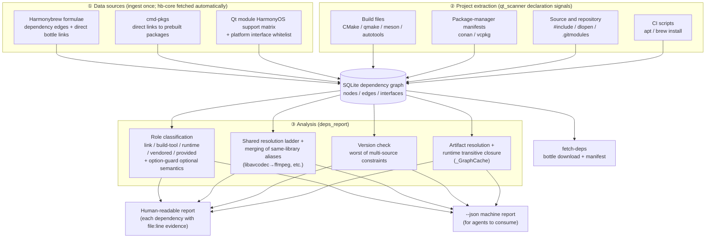
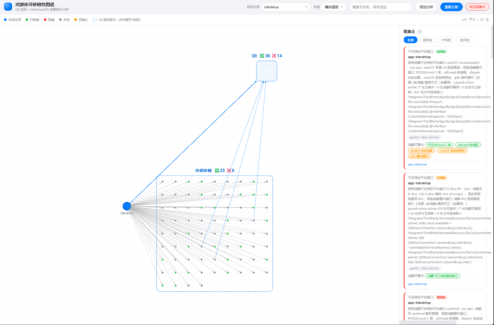

# portgraph dependency analysis · module overview

> Audience: developers and AI agents new to this module. After reading it you should be able to answer four questions:
> **What problem does it solve? How is it designed? What goes in and what comes out? What can't it do?**
> For CLI and data-source details see the [README](README.md); for the role model and coverage overview see [docs/deps-report.md](docs/deps-report.md);
> for quality-engineering records see [docs/opt-reports/](docs/opt-reports/).

---

## 1. What problem it solves

Scenario: you're handed an unfamiliar Qt desktop application to port to HarmonyOS. Before touching the code you must answer three questions; portgraph answers each with one command:

| Question | Command | Output |
|---|---|---|
| Can it be ported? | `analyze <app>` | portable / blocked / uncertain + evidence for the blockers |
| **What exactly does it depend on?** | **`deps <path\|app-name>` (the subject of this report)** | The full dependency picture: each dependency's role, whether version requirements are met, where to get the HarmonyOS artifact |
| Where do I get the artifacts? | `fetch-deps <app>` | Direct bottle downloads + an integration manifest |

Why not just have a person read the build scripts? Three pitfalls (evidence from a large IM application whose README declares 22 third-party dependencies, with a closure of 112):

- **Omissions**: dependencies aren't only in `find_package`. They also hide in bare names and `ns::external_*` imported targets in `target_link_libraries`, `FetchContent` network fetches, git submodules, `apt install` in CI scripts, and `dlopen` in the source. Going through it all by hand without missing one is hard;
- **Mistakes**: the easiest mistake is "it compiled, so it's fine". Cross-compiling only needs headers + libraries, but the app running on the device also needs **transitive runtime .so files**. Bottles don't bundle their dependencies; miss one and the app won't start on the device, while the build gives no hint at all;
- **Slowness**: checking a hundred-plus dependencies one by one for "is it on HarmonyOS, is the version new enough" takes a person hours and isn't reproducible.

`deps` fills all three pitfalls in one scan: for that application it produces a definitive list of **78 direct bottle downloads + 21 that need porting from source**.

## 2. Top-level design (plain version)

The design comes down to three sentences.

### Sentence one: classify dependencies by "what happens if it's missing", not by "what it is"

A traditional dependency list only says "uses zlib". What a porter actually cares about is **what happens if it's missing**, because the remedies are completely different:

| Role | In plain words | Consequence if missing | What to do |
|---|---|---|---|
| `link` | A library "wired into" the app | Compile/link failure | Get the artifact: direct bottle download or cross-compile from source |
| `build-tool` | A tool that does the work (cmake, protoc) | The build machine can't run the build | Install it on the build machine; unrelated to the device |
| `runtime` | A .so needed only when the app runs | Won't start on the device; invisible at build time | Deploy to `entry/libs/arm64-v8a/` |
| `vendored` / `in-tree` | A library whose source ships with the project | None | Built along with the project |
| `provided` | A Qt module | None | Deployed with the Qt for HarmonyOS SDK |
| `test` / `env` | Test-only / CI environment list | — | Not shipped / used only for cross-checking |

The classification goes a bit finer than that (all derived from the build files' own text, not guessed):

- `[optional]`: the declaration sits inside a **CMake option guard that defaults to OFF** (`if(SYSTEMD)` with SYSTEMD off by default). The default build doesn't include it; it gets an optional edge and stays out of the closure and the portability analysis;
- `in-tree`: a bare link name matches a source declaration that ships with the project (FetchContent/submodule). The source is built with the project; it's not an external gap.

### Sentence two: trust only the build files' text; every conclusion can be traced to evidence

The scanner **doesn't execute and doesn't guess**. It reads the dependency declaration signals in files line by line (see section 3), and every dependency in the report carries `file:line` evidence, so an agent citing a conclusion can trace it back and a person can review it. This is the division of labor where "**the LLM does the reasoning, the tool supplies the facts**".

### Sentence three: listing dependencies is only half the job; you also need "where to get it for HarmonyOS"

Behind the analyzer sits a prebuilt SQLite dependency graph: package→package dependency edges and direct bottle links for thousands of Harmonybrew formulae, cmd-pkgs prebuilt packages, and the Qt module HarmonyOS support matrix. Every dependency name pulled from the project is matched through a **shared resolution ladder** (alias table → raw/prefix-suffix → strip version suffix → strip build-variant suffix). The `analyze` / `deps` / `fetch-deps` commands use the same yardstick, so different names for the same library no longer give conflicting answers:

- Has a bottle → give the direct link + HarmonyOS version, and check the version requirement (`✓ satisfied` / `conflict` warning; when a cross-name constraint isn't comparable, an info note asks for manual confirmation);
- Source only → give the repository URL, marked "needs cross-compiling from source";
- A Qt module → give its HarmonyOS support status;
- Platform-specific (X11/AppKit/iphlpapi) → marked not applicable; `analyze`'s macro-guard evidence decides whether it can be trimmed.

### How it runs



## 3. Module boundaries

### 3.1 Input boundary: what goes in

Two kinds of entry point: a local project path (automatically added to the database; rescans are idempotent) or the name of an already-scanned app (the path is recovered from the scan record).

Dependency declaration signals it recognizes (all from the files' own text, grouped by layer):

| Layer | Signals | Example |
|---|---|---|
| CMake | `find_package` / `pkg_check_modules` / `target_link_libraries` bare names·`-lfoo`·`-framework`·`ns::external_*` imported targets / `find_library` / `FetchContent`·`ExternalProject`·`CPM` / `find_program`·`COMMAND` / project-defined wrapper functions (`PACKAGE`/`LIBRARY` keyword convention) / dependency-list engines (`require_dep` convention) | `find_package(OpenSSL 3.0.2 REQUIRED)` |
| qmake | `QT +=` / `LIBS += -lfoo` / `PKGCONFIG +=` | A media player |
| meson | `dependency('name', version:)` / `find_library` / `meson_version`·`cpp_std` / `subproject()` | A media player: `glib-2.0 >= 2.36` |
| autotools | `PKG_CHECK_MODULES` / `AC_CHECK_LIB` | `zlib >= 1.2` |
| Package-manager manifests | conanfile (ranges `[>=1.2 <2]`) / vcpkg.json | A password manager |
| Source | `#include` of third-party headers (16 kinds: zlib/openssl/boost, etc.) / `dlopen`·`QLibrary`·`QPluginLoader` literals | An IM client |
| Repository layout | `.gitmodules` / `3rdparty/` directory / meson `subprojects/*.wrap` | An IM client |
| CI scripts | `apt/brew/pacman install` in `.github/`·`.ci/`·top-level `*.sh` | A screenshot tool: 21 |

**What it can't see** (explicitly unsupported; the report doesn't pretend): link items referenced via `${VAR}`; dynamic library names assembled at runtime; distinguishing which qmake platform scope a block belongs to; "runtime-only" dependencies mentioned only in README/INSTALL and never declared in the build files; **contents of submodules not initialized in a shallow clone** (IM client retrospective: declarations inside the cmake_helpers submodule were invisible, and the e2e reconciliation attributes this honestly rather than reporting a miss); other build systems such as Bazel/Gradle/SCons.

### 3.2 Analysis boundary: how it's processed

- **Purely static**: it doesn't run cmake/configure, only reads text. Fast, works offline, reproducible; the cost is that dynamic behavior is invisible.
- **runtime is derived**: build files never declare "I need library X at runtime". It's derived recursively from link dependencies along the package graph's runtime edges (bottles don't bundle dependencies), with a `needed_by` chain showing what pulled it in.
- **Name matching is heuristic, but the yardstick has converged**: alias table + stripping the lib prefix/version suffix/build-variant suffix + separator-insensitive merging (`LibtorrentRasterbar` ≡ `libtorrent-rasterbar`) + a fallback index of known package names; all three commands share the same resolution function. Homonyms (the multiprecision library MPC vs the player mpc) can still be mismatched; check artifact URLs by hand before relying on them.
- **Version constraints take the worst case**: when several sources declare a version for the same dependency, any conflict makes it a conflict; when a cross-name constraint after alias merging isn't comparable (`libavcodec >= 58` library major version vs the ffmpeg package version), it carries `version_req_from` and an info note asks for manual confirmation.
- **Option guards are a conservative approximation**: declarations inside positive guards of `option`/`feature_option`/`cmake_dependent_option` that default to OFF are marked optional; `else`/`elseif` branches and function/macro bodies aren't evaluated (conservatively treated as required).
- **Dynamic loading recognizes only literals**, filtered by platform macro guards (a `dlopen("libfoo.so")` inside an `#ifdef Q_OS_LINUX` block doesn't count as required on HarmonyOS).

### 3.3 Output boundary: what it doesn't promise

- **No guarantee of runtime completeness**: dynamic loads built from variables can't be determined statically and will be under-reported; final verification on the device is authoritative.
- **It doesn't make decisions for you**: whether to trim an optional dependency, whether to use an old version or build a new one from source on a version conflict — the report gives facts and evidence, and the decision is left to the agent/person.
- **It states its quality**: reconciliation metrics against the README/INSTALL oracle (recall/precision/bug candidates) are archived with the e2e baseline, so "how accurate this tool is on this corpus" can be verified.

### 3.4 Responsibility boundary

| Party | Responsibility |
|---|---|
| deps tool | Supplies facts: the list, roles, version checks, artifact sources, evidence lines |
| agent / person | Decides based on the facts: trimming, choosing versions, scheduling source builds |

## 4. Input → output: real walkthroughs

Each example has three parts: **the original text in the project → what the report actually outputs → what action this output drives** (all outputs are excerpts measured against the latest code).

### Example 1: a downloader — variable versions + option guards + runtime derivation

**Input** (two files working together; versions hidden in `${variables}`, find_package hidden in a project-provided .cmake module):

```cmake
# CMakeLists.txt
set(minBoostVersion 1.76)        # :10
set(minOpenSSLVersion 3.0.2)     # :12
set(minZlibVersion 1.2.11)       # :15

# cmake/Modules/CheckPackages.cmake (pulled in via include())
find_package(Boost ${minBoostVersion} REQUIRED)       # :46
find_package(OpenSSL ${minOpenSSLVersion} REQUIRED)   # :47
find_package(ZLIB ${minZlibVersion} REQUIRED)         # :48
```

**Output** (actual report excerpt):

```text
• Boost >= 1.76 ✓ (package)
    artifact: https://harmonybrew.atomgit.com/bottles/boost-1.92.0_1.arm64_ohos.bottle.tar.gz
    evidence: find_package(Boost 1.76 REQUIRED) cmake/Modules/CheckPackages.cmake:46
• libtorrent-rasterbar (package)
    no artifact → needs building from source
    evidence: pkg_check_modules(libtorrent-rasterbar)
• Systemd  [optional] (platform-iface)
    evidence: find_package(Systemd) dist/unix/CMakeLists.txt:3
    note: systemd: HarmonyOS has no systemd
── runtime dependencies (runtime): 6 ──
• icu4c@78 v78.3 — artifact: …/icu4c@78-78.3_2…tar.gz (transitive from boost)
• xz v5.8.4 / zstd v1.5.7 / zlib-ng-compat / lz4 — all transitive from boost
```

**Action driven**: Boost/OpenSSL/ZLIB bottles are pulled directly by fetch-deps; libtorrent-rasterbar goes on the cross-compile-from-source list (the CamelCase find_package name and the hyphenated pkg_check_modules name are merged into one entry, no more double ghosts); **Systemd is marked optional**: it's under an `if (SYSTEMD)` guard whose option defaults to OFF, so the default build excludes it and it stays out of the closure; **icu4c@78 and the other five runtime libraries appear in no build file**, yet without them the app won't start on the device. They're derived from boost's dependency edges, and fetch-deps pulls them too. This is the line of defense for "it compiled ≠ it runs".

### Example 2: a screenshot tool — FetchContent bundled source + in-tree merging

**Input**:

```cmake
# CMakeLists.txt
FetchContent_Declare(                      # :36
  qtColorWidgets
  GIT_REPOSITORY https://gitlab.com/mattbas/Qt-Color-Widgets.git
  GIT_TAG 5d52e907e50dc88cf969b41cea44665ff6c475b1
)
find_package(KDSingleApplication-qt6 REQUIRED)   # :132 (fallback path when bundled is off)
```

**Output** (actual report excerpt):

```text
• KDSingleApplication-qt6  (in-tree)
    artifact: FetchContent:kdsingleApplication
    evidence: find_package(KDSingleApplication-qt6 REQUIRED) CMakeLists.txt:132
    note: FetchContent (kdsingleApplication): source built with the project, no external artifact needed
• qhotkey  [optional] (in-tree)
    artifact: FetchContent:qHotKey
    note: FetchContent (qHotKey): source built with the project, no external artifact needed
── bundled source (vendored): 3 ──
• qtColorWidgets (pinned 5d52e907…) https://gitlab.com/mattbas/Qt-Color-Widgets.git
• kdsingleApplication (pinned v1.2.1) https://github.com/KDAB/KDSingleApplication.git
```

**Action driven**: the bare names qhotkey/QtColorWidgets in `target_link_libraries` match the project's FetchContent declarations and are merged as **in-tree** (source built with the project). Earlier versions misreported them as external gaps ("no artifact → needs building from source"). The vendored section gives the pinned commits, so offline environments can pre-stage the source.

### Example 3: an IM client — custom wrapper functions + conditional-block annotations

**Input** (the project defines its own `search_dependency()` wrapper, not any standard CMake command):

```cmake
# cmake/Dependencies.cmake
search_dependency(LIBAVCODEC   PACKAGE libavcodec)   # :127
search_dependency(LIBEXIF      PACKAGE libexif)      # :131
search_dependency(OPENAL       PACKAGE openal)       # :135
```

**Output** (actual report excerpt):

```text
• ffmpeg  (package)
    artifact: https://harmonybrew.atomgit.com/bottles/ffmpeg-9.0.2.arm64_ohos.bottle.tar.gz
    note: wrapper declaration libavcodec merged into package ffmpeg
• libexif (package)
    artifact: …/libexif-0.6.26_1…tar.gz
    evidence: search_dependency(PACKAGE libexif cmake/Dependencies.cmake)
• openal-soft (package)
    artifact: https://gitcode.com/OpenHarmonyPCDeveloper/cmd-pkgs/releases/download/pkgs/openal-soft-1.24.3-ohos-aarch64.tar.gz
    evidence: search_dependency(PACKAGE openal cmake/Dependencies.cmake)
• KF5  [optional] (package)
    evidence: require_dep-style list declares KF5 (cmake/Dependencies.cmake:141) [conditional block if(KF5Sonnet_FOUND); not necessarily enabled in the default build]
```

**Action driven**: wrapper functions are extracted using the `PACKAGE`/`LIBRARY`/`MINIMUM_VERSION` keyword convention; openal resolves through the alias table to the cmd-pkgs openal-soft direct link; the KF5 declaration sits inside a conditional block and is annotated "not necessarily enabled in the default build" so the agent can evaluate trimming it.

### Example 4: an IM client — e2e reconciliation (quality inputs and outputs)

The heaviest project in the corpus (22 third-party dependencies in the README, 6358 source files). Summary of the e2e reconciliation report:

```text
portability verdict: blocked (blocking 7 / unknown 19 / platform-excluded 2)
detection recall 71% (12/17) | precision 40% | bug candidates 3
dependency closure 112 (would_download 78 / need_port 21 / provided 9 / …)
```

The reconciliation **attributes** every discrepancy instead of vaguely letting it pass: `ns::external_*` imported targets are recorded with the prefix stripped (openal/xxhash/webrtc…); gsl/range-v3/hunspell are automatically classified as vendored based on `.gitmodules` evidence; the root cause of missing breakpad/crashpad is **honestly marked as uninitialized submodules in a shallow clone** (cmake_helpers not visible), classified as "README possibly outdated / environment gap" rather than the scanner pretending to know.

## 5. Quality assurance

This module isn't "done once it's written". It comes with three layers of quality engineering (process records archived in [docs/opt-reports/](docs/opt-reports/)):

| Layer | Content | Scale |
|---|---|---|
| Unit tests | `tests/test_port_graph.py` | 120 tests |
| e2e reconciliation | 4 corpus projects (codenames corpus-a~d) × oracle (README/INSTALL, manually reviewed) → recall/precision/bug candidates + a baseline of discrepancy attributions | Best baseline: recall 100% / precision 100% / bugs 0 |
| Generalization beyond the corpus | Test rounds on 9+ real projects (painting / document viewing / terminal / music player / video editing / editor / reverse engineering and other types…); problems found in each round are fed back and fixed | Multiple rounds, reports archived |

Performance was engineered in the same rounds: the runtime-closure BFS shares a graph cache (a large painting app previously made 240,000 SQL queries → 0.13s for the analyze phase); platform-interface rules pre-filter on literal anchors (that app has 35MB of source; the full deps run went from 12.4s → 3.1s).

## 6. What the deliverables look like

**① deps human-readable report**: like the three examples above, printed directly to the terminal; each dependency has its role, version check, artifact source, and `file:line` evidence.

**② deps --json** (consumed by agents/tools; structural skeleton):

```jsonc
{
  "project": {"name", "build_system", "version"},
  "qt": {"major", "min_version", "check", "modules": [...]},
  "toolchain": {"cmake_min", "cxx_standard", "tools": [...]},
  "link_deps":   [{"name", "kind", "required", "min_version",
                   "version_req", "version_req_from", "version_check",
                   "evidence": [...], "artifact": {...}}],
  "runtime_deps": [{"name", "version", "artifact", "needed_by": [...]}],
  "dynamic_loads": [...], "test_deps": [...], "vendored": [...],
  "env_deps": [...], "warnings": [{"level", "msg"}]
}
```

**③ fetch-deps output on disk**:

```text
workspace/ohos-libs/
├── zlib/1.3.2/{include,lib,...}          # bottle unpacked and ready
├── openssl@3/3.6.4/...
└── manifest-<app>.json                   # each entry has role/status/URL
                                           # + a toolchain.cmake you can copy directly
```

**④ analyze --summary**: verdict + blockers (risk level + macro-guard evidence) + platform-excluded items (with HarmonyOS replacement interfaces).

**⑤ e2e reconciliation report** (`tests/e2e/reports/*.report.md|.json`): item-by-item discrepancy attribution of oracle × portgraph (match / granularity folding / build tool / optional not enabled / README outdated / ★missed / ★false positive); this is the verifiable baseline for the module's accuracy.

**⑥ Web front end** (`python portgraph.py serve` → http://127.0.0.1:8000): a G6 dependency topology on the left (node color = porting status; Qt modules aggregated and expandable), panels for blockers / platform-excluded items / items pending confirmation on the right, and a node-detail drawer with evidence and direct artifact links:




> The web page currently shows analyze's portability graph and artifact links; the deps role report is delivered via CLI/JSON (it can be wired into node details later).

## 7. Quick start

```bash
python portgraph.py deps <project-path-or-scanned-app-name>   # human-readable report
python portgraph.py deps <app> --json                     # machine-readable
python portgraph.py fetch-deps <app> --dry-run            # artifact preview
python portgraph.py serve                                 # web graph
python portgraph/tests/e2e/run_e2e.py                     # e2e reconciliation (corpus baseline)
```
