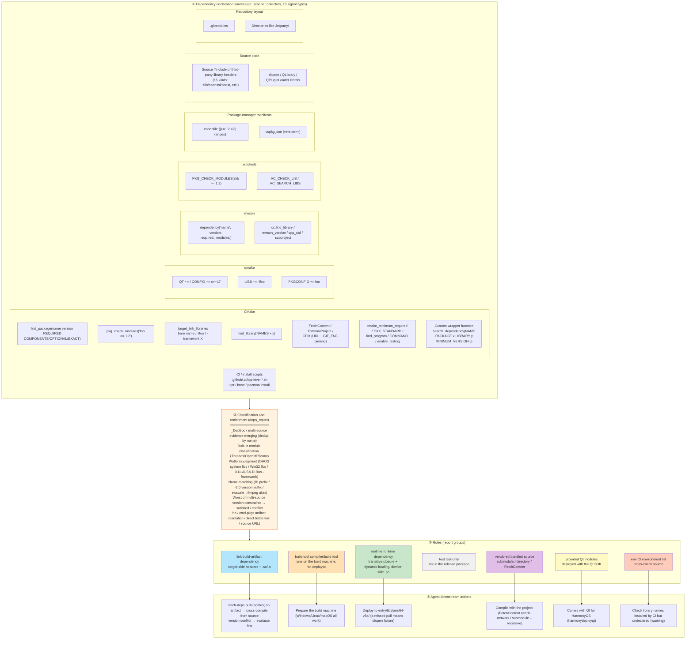

# deps — comprehensive dependency analysis (agent tool)

Given a Qt project (a path or the name of an already-scanned app), produces a **full dependency picture**:
what role each dependency plays, what version it requires, and where its HarmonyOS artifact comes from.

```bash
python portgraph.py deps <project-path|app-name> [--json]
```

Division of labor with the existing commands:

| Command | Question it answers |
|---|---|
| `analyze` | Can it be ported (portable/blocked/uncertain + blockers) |
| **`deps`** | **The full dependency picture: who needs build artifacts, who is a build tool, who is runtime-only, whether version ranges are satisfied** |
| `fetch-deps` | How to get the artifacts (direct bottle download / manifest / integration snippet) |

---

## Dependency role model

A project's dependencies are split into five categories by **role** (one dependency can appear under several views; for example gmp is
both link and, because mpfr depends on it transitively, also appears under runtime):

| role | Meaning | Consequence if missing | Source evidence |
|---|---|---|---|
| `link` | **Build-artifact dependency**: target-side headers + .so/.a, must exist when cross-compiling/linking the app | Compile/link failure | `find_package`, `pkg_check_modules`, `target_link_libraries` bare names/`-lfoo`, `find_library`, Conan/vcpkg manifests, source `#include` of third-party library headers, qmake `LIBS`/`PKGCONFIG`, meson `dependency()`, autotools `PKG_CHECK_MODULES`/`AC_CHECK_LIB`, custom wrapper-function `PACKAGE`/`LIBRARY` declarations (e.g. an IM client's `search_dependency`), dependency-manifest functions `require_dep(…)` (e.g. a bundled dependency-manifest engine), KF components |
| `build-tool` | **Compiler/build-tool dependency**: runs on the build machine, not deployed to the device | The build cannot run (cross-compiled artifacts are unaffected) | `cmake_minimum_required`/`meson_version`, C++ standard, `find_program`, `execute_process/add_custom_command COMMAND`, `find_package(ECM/gettext/OpenMP/…)` |
| `runtime` | **Runtime dependency**: device-side .so, not involved in compilation but the app won't run without it | dlopen/link failure after deployment | The transitive closure of link dependencies (hb runtime edges), `dlopen`/`QLibrary`/`QPluginLoader` literals |
| `test` | Test-only, not in the release package | Tests can't be built | `find_package(GTest/Catch2/…)`, `enable_testing` |
| `vendored` | Source bundled in the project, compiled with it, no external artifact needed | None (pinned commit in the repo) | `.gitmodules`, directories like `3rdparty/`, `FetchContent_Declare`/`ExternalProject_Add`/`CPMAddPackage` (with GIT_TAG/VERSION pinning), `require_source_dep(…)` dependency-manifest declarations (e.g. a bundled dependency-manifest engine), meson `subproject()` |
| `provided` | Qt modules and the like, provided by the Qt SDK / HarmonyOS framework | None (deployed with Qt for HarmonyOS) | `QT +=`, `find_package(Qt5/6 COMPONENTS …)`, `#include <Qt…>`, meson `dependency('qt5'/'qt6', modules: …)` |
| `env` | **Build-machine environment list** declared by CI/scripts (informational, mixes tools and libraries, used as a cross-check source) | — | Package names in `apt/brew/pacman install` in `.github`/`.ci`/top-level `*.sh` |

Special kinds: `system-lib` (zlib/openssl/icu/pthread/threads and the like, shipped with the system or
built-in CMake/meson modules), `win32-system-lib` (user32/ddraw/Wtsapi32.lib and other
Windows-only libraries), `platform-iface` (X11/ALSA/D-Bus/`-framework` and other **direct platform
stacks** that HarmonyOS doesn't support — whether they are actually compiled is decided by analyze's macro-guard evidence), `framework`
(KDE Frameworks components, need cross-compiling from source), and `raw-lib` semantics (bare link names: not
declared via find_package/pkg-config; how to obtain the artifact depends on the name-matching result).

## Version ranges

Each link dependency can carry version constraints from several sources; **when several are present, the worst result wins** (any conflict means conflict):

| Constraint source | Form | Example |
|---|---|---|
| `find_package` minimum version | `min_version` | `find_package(ZLIB 1.2 REQUIRED)` |
| pkg-config constraint | `version_req` | `pkg_check_modules(FF "libavcodec >= 58")` |
| meson constraint | `version_req` | `dependency('glib-2.0', version: '>= 2.36')` |
| autotools constraint | `version_req` | `PKG_CHECK_MODULES([F],[zlib >= 1.2])` |
| Custom wrapper-function constraint | `version_req` | `search_dependency(X PACKAGE y MINIMUM_VERSION ${V})` (`${V}` resolved through `set()` variables (verified on an IM client)) |
| Conan range | `version_range` (kept verbatim) | `zlib/[>=1.2 <2]` |
| vcpkg constraint | `version>=` | `vcpkg.json` dependencies |
| Qt version | `qt.min_version` | `find_package(Qt5 5.15 …)` / meson `qt_req` vs the 5.12/5.15/6.12 available on HarmonyOS |

`version_check` values: `satisfied` / `conflict` (goes into warnings) /
`any` (no constraint) / `unknown` (no available version to compare against, including Conan ranges, which are only approximated by checking the first
`>=x`; and **cross-name version constraints after alias merging** — the library
major-version numbering of `libavcodec >= 58` is not comparable to the ffmpeg package version, so the entry carries `version_req_from`
naming the constraining library, and an info warning asks for manual confirmation).

## Report structure (--json)

```jsonc
{
  "project": {"name", "root", "build_system", "version", "sources"},
  "qt": {"major", "min_version", "check", "available_on_ohos",
         "modules": [{"module", "status", "required"}], "kf_components"},
  "toolchain": {"cmake_min", "cxx_standard", "compiler", "cxx_note",
                "tools": [{"tool", "how", "provided_by": "host|qt-sdk"}],
                "has_testing"},
  "link_deps": [{
      "name", "kind", "required", "min_version", "version_req",
      "version_req_from", "version_range", "version_check",
      "components", "evidence": [...],
      "resolved_node", "port_status", "available_version",
      "artifact": {"ready", "provided", "source", "repo_url", ...},
      "ohos_note"}],
  "runtime_deps": [{"name", "version", "artifact", "needed_by": [...]}],
  "dynamic_loads": [{"name", "resolved_node", "artifact", "how"}],
  "test_deps": [{"name", "source"}],
  "vendored": [{"name", "path", "url", "tag", "note"}],
  "env_deps": [{"name", "resolved_node", "available_version", "evidence"}],
  "counts": {...}, "warnings": [{"level": "warn|info", "msg"}]
}
```

## Agent decision table (by role)

| Role | What the agent should do |
|---|---|
| `link` (artifact available) | `fetch-deps` downloads it; on a version `conflict`, first confirm whether the older version works or build a newer one from source |
| `link` (no artifact) | Cross-compile from the `artifact.repo_url`/`source_url` source; `[optional]` ones can be evaluated for trimming |
| `build-tool` | Just prepare the build machine (Windows/Linux/macOS all work); `provided_by=qt-sdk` ones come with the Qt SDK |
| `runtime` | Deploy to `entry/libs/arm64-v8a/`; pulled in together by `fetch-deps` (bottles don't bundle their dependencies) |
| `test` | Not needed in the release package; only handle it if you need to run tests on HarmonyOS |
| `vendored` | Compiled with the project; FetchContent/CPM need network access (or pre-seeded source in the build cache); after a shallow clone, submodules need `--recursive` |
| `system-lib` / `win32-system-lib` | The former links the system library directly; the latter doesn't apply to HarmonyOS (usually inside a platform block) |
| `platform-iface` | Look at analyze's guard evidence: excluded by a macro guard/platform block → can be trimmed and allowed through; hit unconditionally on a core path → hard blocker |
| `env` | Cross-check source: library names installed by CI but not declared in the build files are reported as warnings (they may come in via variables/custom Find modules and need a follow-up look) |

## Dependency declaration coverage map

The deps report collects dependencies from five layers — **build-system declarations, package-manager manifests, signals embedded in the source, external-fetch declarations,
and environment scripts** — and feeds them into a unified role model:



How to read the diagram:

- **The same dependency can be hit from several sources** (e.g. zlib from `find_package` + qmake
  `-lz` + CI `zlib1g-dev` at once) — `_DepBook` merges evidence by name, so the extra sources no longer
  produce duplicate entries
- **runtime is not declared directly by the build files**: it is derived from the transitive closure of the
  runtime edges of link dependencies through the hb/cmd-pkgs graph (`needed_by` gives the chain that pulls it in), plus source
  dlopen/QLibrary literals
- **The four forms of vendored**: submodule (commit pinned in the repo) / directory (source in the
  repo) / FetchContent-style (fetched over the network at configure time, pinned by GIT_TAG/VERSION) /
  meson subproject (subprojects/*.wrap and override_dependency internal targets)
- **Merging bundled-source declarations with link names** (enhanced in the 2026-09 regression round): when an unresolved
  link name matches a project's bundled-source declaration (git submodule / CPM-FetchContent-ExternalProject
  name or last URL segment / meson subproject and internal target), it is classified `in-tree` (source compiled with the project,
  not an external need_port gap) — with lenient folded matching (strip the lib prefix, strip trailing
  qt5/qt6/system variant tokens: `qtadvanceddocking-qt6` ≡ the last URL segment `Qt-Advanced-Docking-System` of CPM package `ads`);
  a same-named dependency already resolved to an artifact gets the note
  "can be compiled with the project; the bottle is an alternative". Verified on an IM client's kcoreaddons/microtex,
  an editor's ads/QSimpleUpdater, and a reverse-engineering tool's rz_*/zydis
- **find_package(<own project name>) is a self-reference**: the root CMakeLists project() name
  (e.g. find_package(Cutter) in the Cutter plugin sample) is not treated as an external dependency, avoiding a wrong resolution
  to an unrelated package of the same name (verified with cmdpkgs:cutter); a subproject name declared by project(fakevim) in a
  vendored subdirectory doesn't affect the host's declarations
- **env is a cross-check layer**: it doesn't go into link directly; library names installed by CI but not declared in the build files trigger a
  warning, hinting that they may come in via a `${VAR}` reference or a custom Find module

## Dependency closure and scanning conventions

- **Performance**: all runtime-closure BFS runs within a deps report share one node/out-edge cache
  (`_GraphCache`), so total graph queries are O(V+E); previously each link dependency queried the database independently, and
  200 dependencies × a deep-chain graph measured 240,000 SQL queries (measured on a large painting app: node query hit rate
  83%, the analyze phase only 0.13s, no longer a bottleneck). After the out-of-corpus generalization test (2026-09),
  the end-to-end bottleneck is source scanning: platform-interface rules gained **literal-anchor prefiltering**
  (no anchor means no match, semantics unchanged), taking that app's (35MB of source) full deps run
  from 12.4s → 3.1s; remaining hotspots: the anchor any() scan itself and detectors reading the same files repeatedly
  (a shared read cache could come later)

- **Version information comes from the build files verbatim**: `find_package` arguments, pkg-config specs,
  meson `version:`, autotools `PKG_CHECK_MODULES`, Conan/vcpkg manifests,
  `.gitmodules`; when `deps` is given a path it is stored automatically (idempotent rescan), and when given an app name the
  `root_<app_id>` meta recorded by `scan` is used to trace back to the project path
- **Same-name merging**: besides merging by resolved_node (xkbcommon/libxkbcommon),
  entries are also merged by the normalized name of the resolved node (strip lib prefix/@variant) — hb:qrencode and
  cmdpkgs:libqrencode merge into a single qrencode entry, multi-source evidence is kept, and the artifact comes from the
  side with a bottle; when the base has no artifact but the merged item does, the merged item's resolution is used
- **The runtime transitive closure** recurses along the `runtime` edges of the hb/cmd-pkgs graph (skipping macos
  conditions and provided nodes), consistent with `fetch-deps`
- **Dynamic loading only recognizes string literals**; variable concatenation (`QLibrary(name + ".so")`)
  can't be determined statically and will be missed — runtime verification still has to be done on a device
- **Scan-time alias resolution**: when the direct pkg-config/find_package library name misses, it retries via
  `kb_seed.PKG_ALIASES` (libavcodec→ffmpeg, xkbcommon→libxkbcommon,
  pcsc→pcsc-lite, etc.), so different names for the same library no longer produce pkg-unknown ghost nodes —
  name resolution in the analyze / fetch-deps / deps commands is therefore consistent
- **Merging different names of the same library + separator-stripping fallback resolution**: the flattened CamelCase name from find_package
  (`LibtorrentRasterbar` → `libtorrentrasterbar`) and the hyphenated pkg-config name
  (`libtorrent-rasterbar`) refer to the same library, so at scan time they're grouped by a separator-stripped key and merged into one
  node (no more duplicate ghost nodes/duplicate need_port); if still unmatched,
  `kb_seed.build_dashless_index` (which only includes known hb:/cmdpkgs: package sources, key length ≥6
  to avoid collisions) provides a fallback resolution to the known hyphenated package name
- **Declarations inside CMake option guards (default OFF) are marked optional**: for `option` /
  `feature_option` / `feature_option_dependent` / `cmake_dependent_option`
  options defaulting to OFF, find_package/pkg_check_modules inside their positive `if(<OPTION>)` guard
  are treated as not part of the default build (from the e2e postmortem of a downloader's
  `if (SYSTEMD)`): the deps report marks the entry `required=false` + a note;
  `analyze`/`fetch-deps` connect it with an **optional edge** (excluded from the runtime closure and
  portability analysis); Find<Name>.cmake module files inherit the guard of find_package(Name);
  when a package has both required and optional declaration sites, it is treated as required (conservative). Note that
  `else`/`elseif` branches and function/macro bodies are not evaluated (conservatively treated as required)
- **Shared resolution ladder (kb_seed.resolve_pkg_name)**: the deps report and the scan phase
  (project_scanner) share one resolution function, which tries in order:
  ① the alias table `kb_seed.PKG_ALIASES` (hb package naming, e.g. sqlite3→sqlite,
  libavfilter→ffmpeg, gio-2.0→glib; **takes precedence over the original name**, so different names for the same library merge into
  the same node, eliminating duplicate sqlite3/sqlite artifact downloads) → ② original name / add lib prefix /
  strip lib prefix → ③ strip the pkg-config version suffix (glib-2.0→glib) → ④ strip
  find_library build-form suffixes (jpeg-static→jpeg, libFLAC_dynamic→flac);
  different names for the same library no longer produce pkg-unknown ghost nodes — name resolution in the analyze / fetch-deps / deps
  commands is therefore consistent (when unmatched, ghost nodes use the alias's canonical name,
  unifying botan3/botan-3); build-tool/platform-interface names (python3/ecm/systemd)
  are skipped at scan time, with no ghost created
- Toolchain detection only records `COMMAND`/`find_program` tokens that are **known tool names or match a characteristic suffix**
  (`*-config`/`*-scanner`/`*-codegen`/`glib-*`), to avoid treating arbitrary
  executable names as dependencies
- CMake dependency detection covers **the project's own .cmake modules** (cmake/Modules/*.cmake pulled in via `include()`
  — the CheckPackages.cmake pattern of a downloader project),
  and resolves `set(var x)` variable substitution into the version slot of find_package/pkg_check_modules
  (`${minBoostVersion}` → 1.76)
- Custom wrapper-function detection relies on the **PACKAGE/LIBRARY keyword convention** (heuristic):
  the function name must be defined by a project function()/macro(), and the call site must carry `PACKAGE <name>` to
  be recognized; other custom wrapper forms are not guaranteed to be covered
- `target_link_libraries` excludes in-project targets (add_library/add_executable),
  `${VAR}`/generator expressions, paths, and link flags, keeping only bare library names normalized by `.lib/.so/.a`;
  `ns::external_<name>` imported targets (a convention of external wrapper layers such as cmake_helpers) have the
  `external_` prefix stripped and are recorded as high-confidence external dependencies (marked `ext_target`; all of an IM client's
  third-party libraries go this way); other `Foo::Bar` (Qt5::/PkgConfig::/in-project
  lib_*) are not treated as external package declarations

## The role field in the fetch-deps manifest

Each entry in the `fetch-deps` manifest gains a `role` (decided by closure depth):

- `link`: a direct dependency of the app (depth 1, needed for compiling/linking)
- `runtime`: a transitive dependency (depth ≥2, device-side .so)
- `provided`: Qt modules; `target`: the app itself
- `test`: test frameworks (GTest/Catch2/…), not in the release package, handled only when tests need to run on a HarmonyOS
  device (status still follows artifact availability; download info is kept when a bottle exists)
- `build-tool`: CMake built-in compiler features (OpenMP, provided with the NDK, status=
  provided) or host build-tool packages (ghost nodes with no artifact such as ECM, just install them on the build machine)

The manifest top level gains a `roles` count. Depth-based classification is a **graph-level** approximation; for precise classification with version-range/
REQUIRED/OPTIONAL semantics, use the `deps` report.

## Known limitations

- **libav* version constraints are not comparable**: the version number in `pkg_check_modules("libavcodec >= 58")` is the
  **library major version** (58 ≈ ffmpeg 4.x), a different scale from ffmpeg release versions (e.g. 7.1).
  After cross-name merging into ffmpeg, such constraints carry `version_req_from` (the constraining library name),
  and `version_check` records `unknown` instead of a false `conflict`

- **Declarations inside other platforms' if blocks are downgraded to required=False**: target_link_libraries/find_library/pkg_check_modules
  inside platform-specific blocks such as `if(APPLE)`/`if(WIN32)`/
  `if(HAIKU)`/`if(ANDROID)`/`if(SYSTEM_NAME STREQUAL "Darwin"/"Windows")`
  are annotated `note="inside an if(…) platform block"` and don't get runtime edges; `UNIX`/`LINUX`/
  `POSIX`/`OHOS` are treated as active on HarmonyOS (`if(UNIX AND NOT APPLE)` is not downgraded),
  negated conditions like `NOT WIN32` are not downgraded, and `else` branches are conservatively not evaluated (2026-09 generalization round:
  verified on a downloader's Darwin/Windows blocks, a terminal's HAIKU/FreeBSD blocks, a document viewer's mobile
  ANDROID block, a password manager's FindQREncode WIN32 block, and an IM client's APPLE block).
  Limitation: platform inheritance from a find_package inside a platform block into the contents of the Find<Name>.cmake module
  is not implemented (conservatively treated as required)
- **KF components resolve to kf:<comp> nodes rather than through the package-name ladder**: KF Archive ≠ libarchive,
  KF Config ≠ libconfig (same name, different meaning); the deps table and the fetch-deps closure are consistent
  (kf nodes are need_port and need KF6 cross-compiled from source)
- **Container-name allowlist for in-tree judgment**: only `libraries`/`libs` parent directories (or vendored
  path segments) count as bundled-library collections; functional grouping directories like `generators` (a document viewer's
  generators/poppler is format-generator plugin code, not poppler source) are not judged in-tree
- Matching find_package names → hb package names relies on the `kb_seed.resolve_package` alias table +
  prefix/suffix rules; same names with different meanings (e.g. the multi-precision library MPC vs the music player mpc) can mismatch, so
  check artifact URLs manually before relying on them
- Conan range checks are approximate (taking the first `>=x`); `<y` upper bounds are not compared
- Bare `target_link_libraries` names can't distinguish "external library" from "target provided by a custom Find
  module"; link items referenced via `${VAR}` are completely invisible (cross-checking the CI list can partly fill the gap)
- **Uninitialized-submodule blind spot**: when a shallow clone doesn't fetch submodules, find_package/integration-choice logic
  inside the submodules is invisible (an IM client's cmake/ is cmake_helpers:
  the either-or integration of breakpad/crashpad is implemented inside it, and the main repo only sees the
  external_crash_reports wrapper target). A complete solution needs clone --recurse-submodules
  or downgraded annotation based on the missing paths hinted at by .gitmodules; this is a known residual in the current version
- CI environment lists use distribution package names (libfoo-dev), so mapping them back to library names is approximate; and they're only collected within
  `.github/`, `.ci/`, and top-level `*.sh`
- meson `subproject()` only has a name; the version depends on the contents of subprojects/*.wrap (.wrap is not
  parsed); meson internal targets (override_dependency, e.g. rizin's rz_*)
  and bundled subprojects under subprojects/ are classified in-tree and not reported as need_port; `'@0@'` string
  interpolation placeholders are stripped ('libpcre2-@0@' → libpcre2)
- Dynamic loading only recognizes literals (see above); dependencies inside qmake platform scope blocks (`unix {}`/`win32 {}`)
  are not attributed to a platform
