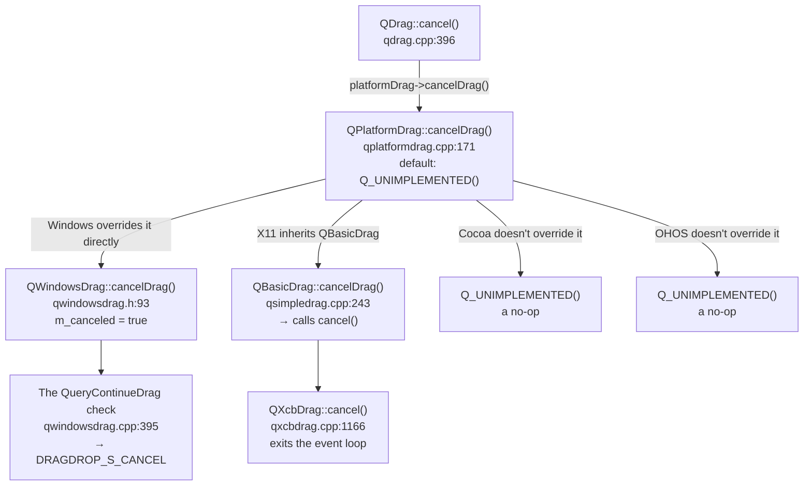

# Cross-platform support for QDrag::cancel()

> Based on the Qt 5.15 HarmonyOS branch (tqtc/harmonyos-5.15.16) source; every conclusion carries a `file:line` reference.

---

## 1. What the feature does

`QDrag::cancel()` is a **static public API** Qt provides for programmatically cancelling a drag that's in progress.

```cpp
// qdrag.h:87
static void cancel();
```

```cpp
// qdrag.cpp:396-400
void QDrag::cancel()
{
    if (QPlatformDrag *platformDrag = QGuiApplicationPrivate::platformIntegration()->drag())
        platformDrag->cancelDrag();
}
```

- **Introduced in**: Qt 5.7 (`qdrag.cpp:393` `// \since 5.7`)
- **The call chain**: `QDrag::cancel()` → `QPlatformDrag::cancelDrag()` (a virtual) → each platform's QPA plugin implementation
- **The QPA default implementation**: `Q_UNIMPLEMENTED()`, i.e. a no-op (`qplatformdrag.cpp:171-174`)

```cpp
// qplatformdrag.cpp:171-174 — the default implementation, which does nothing
void QPlatformDrag::cancelDrag()
{
    Q_UNIMPLEMENTED();
}
```

### Architecture overview



---

## 2. The scenario

### 2.1 What programmatic cancellation is

`QDrag::cancel()` is different from the user pressing ESC. It's the **application code actively aborting** a drag in progress. Typical scenarios:

| Scenario | Description |
|----------|-------------|
| Timeout cancellation | The drag isn't released within N seconds, so it's aborted automatically (preventing a stuck user or a drag timeout) |
| A business interruption | Data validation fails or the network state changes mid-drag, so the drag is aborted |
| A page transition | A page navigation or dialog is triggered mid-drag and the current drag needs cancelling |
| A race condition | Another operation needs exclusive control of the drag resources |

### 2.2 How it differs from ESC cancellation

| Mechanism | Triggered by | Path |
|-----------|--------------|------|
| ESC cancellation | The user pressing a key | Each platform's native OS handling (Windows: `fEscapePressed`, `qwindowsdrag.cpp:395`) |
| `QDrag::cancel()` | Application code | `QDrag::cancel()` → `QPlatformDrag::cancelDrag()` → the platform implementation |

> **Note**: on Windows, ESC cancellation goes through the native OLE callback `QueryContinueDrag` and doesn't involve `QDrag::cancel()`. `QDrag::cancel()` is purely for programmatic cancellation.

---

## 3. Platform support

### 3.1 Overview

| Platform | Implemented? | How | Key code |
|----------|:------------:|-----|----------|
| **Windows** | ✅ | Overrides `cancelDrag()` directly, setting a static flag the OLE callback checks | `qwindowsdrag.h:93`, `qwindowsdrag.cpp:390-396` |
| **X11 (Linux)** | ✅ | Inherits `QBasicDrag`, whose `cancelDrag()` → `cancel()` exits the event loop | `qsimpledrag.cpp:243`, `qxcbdrag.cpp:1166` |
| **macOS (Cocoa)** | ❌ | Doesn't override it and doesn't inherit `QBasicDrag` | No cancelDrag anywhere in `qcocoadrag.mm/h` |
| **OHOS (HarmonyOS)** | ❌ | Doesn't override it and doesn't inherit `QBasicDrag` | No override in `qohosplatformdrag.h:12-21` |

> The official Qt documentation (`qdrag.cpp:391`) says so explicitly in a comment: `"This is currently implemented on Windows and X11."`

### 3.2 A detailed comparison

| Dimension | Windows | X11 (xcb) | macOS (Cocoa) | OHOS |
|-----------|---------|-----------|---------------|------|
| `cancelDrag()` override | ✅ `qwindowsdrag.h:93` | ✅ Inherited from `QBasicDrag`<br/>`qsimpledrag_p.h:77` | ❌ | ❌ |
| Inherits QBasicDrag | ❌ Inherits QPlatformDrag directly | ✅ `qxcbdrag.h:71` | ❌ | ❌ |
| Where cancel is checked | The OLE `QueryContinueDrag`<br/>`qwindowsdrag.cpp:395`<br/>→ `DRAGDROP_S_CANCEL` | `QBasicDrag::cancelDrag()`<br/>`qsimpledrag.cpp:243-246`<br/>→ `cancel()` exits the event loop | None | None |
| ESC key handling | The OS-native `fEscapePressed`<br/>`qwindowsdrag.cpp:395` | `QBasicDrag`'s event filter<br/>`qsimpledrag.cpp:172,195` | No cancel-related code in the repository | The event filter swallows KeyPress<br/>`qohosplatformdrag.cpp:82-88` |
| How the drag blocks | The OLE `DoDragDrop()` blocks synchronously | A `QBasicDrag` local event loop | The default Qt mechanism | `QEventLoop::exec()`<br/>`qohosplatformdrag.cpp:130` |
| How the block ends | OLE returns (cancel/drop) | A callback quits the event loop | The default Qt mechanism | The native callback `ARKUI_DRAG_STATUS_ENDED`<br/>`qnativenode.cpp:479` |

### 3.3 Each platform's implementation in detail

#### Windows — ✅ implemented

```cpp
// qwindowsdrag.h:93 — the cancelDrag override
void cancelDrag() override { QWindowsDrag::m_canceled = true; }
```

```cpp
// qwindowsdrag.cpp:390-396 — the OLE callback checks the canceled flag
STDMETHODIMP QWindowsOleDropSource::QueryContinueDrag(BOOL fEscapePressed, DWORD grfKeyState)
{
    SCODE result = S_OK;
    if (fEscapePressed || QWindowsDrag::isCanceled()) {
        result = DRAGDROP_S_CANCEL;  // tells OLE to cancel the drag
    }
    // ...
}
```

**The mechanism**: `cancelDrag()` sets the static `m_canceled = true` flag → OLE checks that flag in the `QueryContinueDrag` callback → it returns `DRAGDROP_S_CANCEL` → OLE cancels the drag → `DoDragDrop()` returns → `drag->exec()` returns `Qt::IgnoreAction`.

#### X11 (xcb) — ✅ implemented

```cpp
// qsimpledrag_p.h:71,77 — the intermediate QBasicDrag layer overrides cancelDrag
class QBasicDrag : public QPlatformDrag, public QObject {
    void cancelDrag() override;  // line 77
    virtual void cancel();       // line 85 — a template method for subclasses to implement
};
```

```cpp
// qsimpledrag.cpp:243-246 — cancelDrag delegates to cancel()
void QBasicDrag::cancelDrag()
{
    // ... exits the event loop
    cancel();
}
```

```cpp
// qxcbdrag.h:80 — QXcbDrag overrides cancel()
void cancel() override;

// qxcbdrag.cpp:1166-1177
void QXcbDrag::cancel()
{
    qCDebug(lcQpaXDnd) << "dnd was canceled";
    QBasicDrag::cancel();
    // ... cleans up the Xdnd state
    canceled = true;
}
```

**The mechanism**: `cancelDrag()` (inherited from QBasicDrag) → `cancel()` (overridden by QXcbDrag) → exits the local event loop → sends XdndLeave to tell the target it's cancelled → `drag->exec()` returns.

#### macOS (Cocoa) — ❌ not implemented

`QCocoaDrag` inherits `QPlatformDrag` directly, doesn't override `cancelDrag()`, and doesn't inherit `QBasicDrag`. Calling `QDrag::cancel()` falls through to `QPlatformDrag::cancelDrag()` → the `Q_UNIMPLEMENTED()` no-op.

> Source evidence: the keywords "cancel" / "abort" have zero matches across `qcocoadrag.mm`, `qcocoadrag.h`, and `qnsview_dragging.mm`.

#### OHOS (HarmonyOS) — ❌ not implemented

```cpp
// qohosplatformdrag.h:12-21 — the QOhosPlatformDrag declaration, with no cancelDrag override
class QOhosPlatformDrag : public QPlatformDrag
{
public:
    QOhosPlatformDrag();
    ~QOhosPlatformDrag() override;
    virtual void handlePreDrop() = 0;       // there is pre-drop handling
    virtual void updateDropAction(Qt::DropAction) = 0;  // there is action updating
    // ❌ no cancelDrag() override
};
```

The OHOS drag blocking mechanism (`qohosplatformdrag.cpp:108-135`):

```cpp
// qohosplatformdrag.cpp:108-135 — drag() blocks on a QEventLoop
Qt::DropAction QOhosPlatformDragImpl::drag(QDrag *drag)
{
    auto *initiatorView = findInitiatorViewForDragOrNull();
    m_activeEventFilterHandle = installDragEventFilter();  // swallows all input events

    auto eventLoop = std::make_shared<QEventLoop>();
    m_dropAction = drag->defaultAction();

    initiatorView->startDrag(
        {dragPixmap.toImage()}, drag->hotSpot(),
        *drag->mimeData(),
        [this, eventLoop](Qt::DropAction dropAction) {  // the native callback
            m_dropAction = dropAction;
            eventLoop->quit();  // the only way out
        });

    eventLoop->exec();  // blocks waiting for the native callback
    return m_dropAction;
}
```

The OHOS native drag callback handling (`qnativenode.cpp:473-501`):

```cpp
// qnativenode.cpp:473-493 — the native callback handles the drag result
[context](::ArkUI_DragAndDropInfo *dragAndDropInfo) mutable {
    auto dragStatus = OH_ArkUI_DragAndDropInfo_GetDragStatus(dragAndDropInfo);

    if (dragStatus == ARKUI_DRAG_STATUS_ENDED) {  // only the ENDED status is handled
        ArkUI_DragResult dragResult = ARKUI_DRAG_RESULT_FAILED;
        OH_ArkUI_DragEvent_GetDragResult(dragEvent, &dragResult);

        auto qtDropAction =
            dragResult == ARKUI_DRAG_RESULT_SUCCESSFUL
                ? mapQOhosArkUiDropOperationToQt(...)
                : Qt::IgnoreAction;  // FAILED → IgnoreAction

        dropActionConsumer(qtDropAction);  // triggers eventLoop->quit()
    }
}
```

**Impact analysis for OHOS**:

| Aspect | Notes |
|--------|-------|
| Programmatic `QDrag::cancel()` | ❌ Ineffective. `cancelDrag()` → the `Q_UNIMPLEMENTED()` no-op, so the drag isn't aborted |
| Does it crash or hang? | ❌ No. The native drag is bound to end (the user lets go), and the callback triggers `eventLoop->quit()` |
| The user drops on an invalid area | ✅ Works. The native callback gives `ARKUI_DRAG_RESULT_FAILED` → `Qt::IgnoreAction` |
| A normal drop | ✅ Works. The native callback gives `ARKUI_DRAG_RESULT_SUCCESSFUL` → the Qt drop action |
| The ESC key | ❌ Invisible at the Qt layer (the event filter swallows KeyPress, `qohosplatformdrag.cpp:82-88`) |

> **Conclusion**: OHOS's missing `cancelDrag()` makes the **programmatic cancellation scenario ineffective**, but it doesn't crash or deadlock. The drag simply continues until the native system ends it naturally.

---

## 4. A demo (based on the official Qt example)

The following builds on Qt's official `draggableicons` example (`qtbase/examples/widgets/draganddrop/draggableicons/`), adding a demonstration of programmatic cancellation (automatically cancelling a drag on a timeout).

> **The official example's path**: `qtbase/examples/widgets/draganddrop/draggableicons/dragwidget.cpp`

### 4.1 The official example: starting a standard drag

`mousePressEvent` from the official `draggableicons` (`dragwidget.cpp:140-176`):

```cpp
void DragWidget::mousePressEvent(QMouseEvent *event)
{
    QLabel *child = static_cast<QLabel*>(childAt(event->pos()));
    if (!child)
        return;

    QPixmap pixmap = *child->pixmap();

    // Serialize the drag data
    QByteArray itemData;
    QDataStream dataStream(&itemData, QIODevice::WriteOnly);
    dataStream << pixmap << QPoint(event->pos() - child->pos());

    QMimeData *mimeData = new QMimeData;
    mimeData->setData("application/x-dnditemdata", itemData);

    QDrag *drag = new QDrag(this);
    drag->setMimeData(mimeData);
    drag->setPixmap(pixmap);
    drag->setHotSpot(event->pos() - child->pos());

    // A translucent effect
    QPixmap tempPixmap = pixmap;
    QPainter painter;
    painter.begin(&tempPixmap);
    painter.fillRect(pixmap.rect(), QColor(127, 127, 127, 127));
    painter.end();
    child->setPixmap(tempPixmap);

    // exec() blocks synchronously until the drag ends
    if (drag->exec(Qt::CopyAction | Qt::MoveAction, Qt::CopyAction) == Qt::MoveAction) {
        child->close();
    } else {
        child->setPixmap(pixmap);
    }
}
```

### 4.2 The extension: adding programmatic cancellation (an automatic timeout)

Building on the official example, add a timeout timer: if the drag isn't released within 5 seconds, call `QDrag::cancel()` to cancel it.

```cpp
// dragwidget.h — add the timeout member
class DragWidget : public QWidget {
    // ...
private:
    QTimer *m_dragTimeout;  // the drag timeout timer
};
```

```cpp
// dragwidget.cpp — add the timeout cancellation logic
void DragWidget::mousePressEvent(QMouseEvent *event)
{
    QLabel *child = static_cast<QLabel*>(childAt(event->pos()));
    if (!child)
        return;

    QPixmap pixmap = *child->pixmap();

    QByteArray itemData;
    QDataStream dataStream(&itemData, QIODevice::WriteOnly);
    dataStream << pixmap << QPoint(event->pos() - child->pos());

    QMimeData *mimeData = new QMimeData;
    mimeData->setData("application/x-dnditemdata", itemData);

    QDrag *drag = new QDrag(this);
    drag->setMimeData(mimeData);
    drag->setPixmap(pixmap);
    drag->setHotSpot(event->pos() - child->pos());

    // ★ New: cancel automatically after 5 seconds
    m_dragTimeout = new QTimer;
    m_dragTimeout->setSingleShot(true);
    connect(m_dragTimeout, &QTimer::timeout, [] {
        QDrag::cancel();  // programmatically cancel the current drag
    });
    m_dragTimeout->start(5000);

    QPixmap tempPixmap = pixmap;
    QPainter painter;
    painter.begin(&tempPixmap);
    painter.fillRect(pixmap.rect(), QColor(127, 127, 127, 127));
    painter.end();
    child->setPixmap(tempPixmap);

    // exec() blocks synchronously
    Qt::DropAction result = drag->exec(Qt::CopyAction | Qt::MoveAction, Qt::CopyAction);

    m_dragTimeout->stop();
    m_dragTimeout->deleteLater();

    if (result == Qt::MoveAction) {
        child->close();
    } else {
        child->setPixmap(pixmap);
    }
}
```

### 4.3 What happens on each platform

| Platform | Behavior after the 5-second timeout | `exec()`'s return value |
|----------|-------------------------------------|-------------------------|
| Windows | ✅ The drag aborts immediately and `exec()` returns | `Qt::IgnoreAction` |
| X11 (Linux) | ✅ The drag aborts immediately and `exec()` returns | `Qt::IgnoreAction` |
| macOS | ❌ Nothing happens; the drag continues, and although the timer fires after 5 seconds, `cancel()` is a no-op | It only returns once the user lets go |
| OHOS | ❌ Nothing happens; the drag continues, and although the timer fires after 5 seconds, `cancel()` is a no-op | It only returns once the user lets go |

> **Note**: on Windows, `drag->exec()` internally goes through the OLE `DoDragDrop()`, and Qt's `QTimer` depends on an event loop. OLE's message pump processes Qt timer events, so `QTimer::timeout` can still fire during a drag. On X11, `exec()` runs a `QBasicDrag` local event loop, where `QTimer` likewise fires normally.

---

## 5. Summary of conclusions

| # | Conclusion | Evidence level | Key code references |
|---|------------|:--------------:|---------------------|
| 1 | Windows ✅ implements `cancelDrag()`, cancelling via the OLE `DRAGDROP_S_CANCEL` | Strong | qwindowsdrag.h:93, qwindowsdrag.cpp:390-396 |
| 2 | X11 ✅ implements it indirectly by inheriting `QBasicDrag`, with `cancelDrag()` → `cancel()` | Strong | qsimpledrag_p.h:77, qsimpledrag.cpp:243, qxcbdrag.cpp:1166 |
| 3 | macOS ❌ doesn't implement it; `cancelDrag()` falls through to the `Q_UNIMPLEMENTED()` no-op | Strong | No cancelDrag in qcocoadrag.mm/h, qplatformdrag.cpp:171-174 |
| 4 | OHOS ❌ doesn't implement it; `cancelDrag()` falls through to the `Q_UNIMPLEMENTED()` no-op | Strong | No override in qohosplatformdrag.h:12-21, qplatformdrag.cpp:171-174 |
| 5 | Calling `QDrag::cancel()` on OHOS doesn't crash or hang, but silently does nothing | Strong | The no-op at qplatformdrag.cpp:173 + the event loop at qohosplatformdrag.cpp:130 exiting via the native callback |
| 6 | The OHOS native drag can report a cancel result (`ARKUI_DRAG_RESULT_FAILED` → `Qt::IgnoreAction`) | Strong | qnativenode.cpp:484-493 |

### Still to verify

- [ ] Whether the OHOS native ArkUI drag framework has its own ESC/cancel API (this needs checking against the OHOS SDK documentation; the current repository code doesn't call one)
- [ ] Whether macOS has a drag cancel mechanism outside the QPA layer (such as the native NSDraggingSession API)

---

## Appendix: source file index

| File | Path (relative to qtbase/src) | Notes |
|------|-------------------------------|-------|
| qdrag.h / qdrag.cpp | gui/kernel/ | The Qt public API, with the static `cancel()` method |
| qplatformdrag.h / .cpp | gui/kernel/ | The QPA abstraction layer, with the `cancelDrag()` virtual |
| qsimpledrag_p.h / .cpp | gui/kernel/ | The intermediate `QBasicDrag` base class, which overrides `cancelDrag()` |
| qwindowsdrag.h / .cpp | plugins/platforms/windows/ | The Windows QPA drag implementation |
| qxcbdrag.h / .cpp | plugins/platforms/xcb/ | The X11 QPA drag implementation |
| qcocoadrag.h / .mm | plugins/platforms/cocoa/ | The macOS QPA drag implementation |
| qohosplatformdrag.h / .cpp | plugins/platforms/ohos/ | The OHOS QPA drag implementation |
| qnativenode.cpp | plugins/platforms/ohos/render/ | The OHOS native drag callback handling |

---

## References

- 🛠️ Verified in the Qt source (the Qt 5.15.16 OHOS branch `tqtc/harmonyos-5.15.16`, commit 962aa625):
  - `gui/kernel/qdrag.cpp:391,393,396` — the `QDrag::cancel()` static method implementation + the official comment "This is currently implemented on Windows and X11."
  - `gui/kernel/qplatformdrag.cpp:171,173` — `QPlatformDrag::cancelDrag()`'s default implementation falling through to `Q_UNIMPLEMENTED()`
  - `gui/kernel/qsimpledrag_p.h:71,77` / `qsimpledrag.cpp:172,243` — the intermediate `QBasicDrag` base class overriding `cancelDrag()` (the X11 event loop)
  - `plugins/platforms/windows/qwindowsdrag.cpp:390,395` — the Windows QPA implementation using an OLE flag
  - `plugins/platforms/xcb/qxcbdrag.cpp:1166` — the X11/XCB QPA implementation
  - `plugins/platforms/cocoa/` — the macOS Cocoa QPA (`cancelDrag` falls through to `Q_UNIMPLEMENTED()`)
  - `plugins/platforms/ohos/qohosplatformdrag.cpp:82,108,130` / `qohosplatformdrag.h:12` — the OHOS QPA's empty implementation
  - `plugins/platforms/ohos/render/qnativenode.cpp:473,479,484` — the OHOS native drag callback handling
- 📖 Official Qt documentation:
  - [The draggableicons example](https://doc.qt.io/qt-5/qtwidgets-draganddrop-draggableicons-example.html) (`qtbase/examples/widgets/draganddrop/draggableicons/`) — the official drag example this page's demo extends
  - [The QDrag class documentation](https://doc.qt.io/qt-5/qdrag.html) — the API reference for the static `cancel()` method
- 💼 Hands-on experience: verifying `QDrag::cancel()`'s behavior on OHOS (silently ineffective; exec returns once the native drag ends naturally, with no crash or hang)
- Related knowledge pages: [[qt-harmonyos-platform-limits]] §Cross-platform API differences, [[qt-harmonyos-api]] §Drag-and-drop APIs
